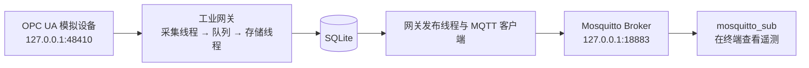

# 本地开发与运行指南

本文面向第一次获取项目的开发者，介绍如何在自己的 Linux 机器上准备依赖、编译网关，并通过本地模拟设备看到第一条遥测消息。

主流程使用项目现有的 C++ OPC UA 模拟服务器和本地 Mosquitto Broker，不要求真实工业设备、平台后端或额外 Python 模拟器环境。操作完成后，数据路径为：



本文中的安装、下载和启动命令由使用者按需手工执行，项目构建不会自动安装依赖。本文编写时核对了源码、已有依赖记录及命令格式，未在全新机器执行整套安装与运行流程，也未运行自动化测试。

## 1. 环境要求与路径约定

基准环境为 Ubuntu 22.04、GCC/G++ 11.4、CMake 3.22。项目使用 C++17，要求 CMake 至少 3.16。其他 Linux 发行版需自行对应包名和版本；当前代码包含 POSIX 信号、线程及 Linux 串口相关实现，不提供原生 Windows/macOS 构建步骤。

本指南统一使用以下路径和地址：

| 项目 | 本文使用的值 |
|---|---|
| 项目仓库 | `$HOME/code/industrial-iot-platform` |
| 网关目录 | `$HOME/code/industrial-iot-platform/edge/industrial-gateway` |
| open62541 源码 | `$HOME/src/open62541-1.5.10` |
| open62541 安装目录 | `$HOME/.local/open62541-1.5.10` |
| 演示配置、日志、数据库 | `/tmp/industrial-gateway-local` |
| Broker | `127.0.0.1:18883` |
| 模拟设备 | `opc.tcp://127.0.0.1:48410` |
| 网关 ID / MQTT Client ID | `gateway-local-001` |

项目放在其他目录时，替换对应的 `cd` 路径。每个终端都独立设置工作目录，不依赖另一个终端中的环境变量。

`/tmp` 目录用于首次本地演示，系统可能在重启或清理时删除其中内容。长期使用应把运行配置、日志和数据库放到自己的持久化目录。再次使用同一演示目录时，已有 SQLite 配置和待发送消息会保留。

## 2. 准备工具并获取项目

在 Ubuntu 22.04 上，手工安装构建工具：

```bash
sudo apt update
sudo apt install build-essential cmake pkg-config git python3
```

Python 3 用于 open62541 构建时的代码生成，本地演示不需要安装 Python 第三方包。

把下面的仓库地址替换为项目实际地址；已有工作副本时直接进入网关目录，不重复克隆：

```bash
mkdir -p "$HOME/code"
git clone '替换为项目实际仓库地址' "$HOME/code/industrial-iot-platform"
cd "$HOME/code/industrial-iot-platform/edge/industrial-gateway"
```

应能看到 `CMakeLists.txt`、`cmake/`、`src/`、`include/`、`config/`、`docs/` 和 `tests/`。当前程序入口是 `src/main.cpp`，不是根目录的空 `main.cpp`。

## 3. 准备第三方依赖

### 3.1 网关需要的系统开发包

```bash
sudo apt install \
  libspdlog-dev \
  libyaml-cpp-dev \
  libsqlite3-dev \
  nlohmann-json3-dev \
  libmosquitto-dev \
  libmodbus-dev
```

对应关系和现有开发环境的库版本如下。发行版软件包可能带有安全更新后缀，下面记录的是库版本参考，不要求旧的软件包修订号仍可从软件源安装。

| 开发包 | 用途 | 现有环境的库版本 |
|---|---|---|
| `libspdlog-dev` | 日志 | 1.9.2 |
| `libyaml-cpp-dev` | YAML 解析 | 0.7.0 |
| `libsqlite3-dev` | 本地存储 | 3.37.2 |
| `nlohmann-json3-dev` | JSON 配置与序列化 | 3.10.5，CMake 要求至少此版本 |
| `libmosquitto-dev` | MQTT 客户端 | 2.0.11 |
| `libmodbus-dev` | Modbus TCP / RTU | 3.1.6 |

可以查看本机安装记录：

```bash
dpkg-query -W libspdlog-dev libyaml-cpp-dev libsqlite3-dev \
  nlohmann-json3-dev libmosquitto-dev libmodbus-dev
pkg-config --modversion libmosquitto libmodbus sqlite3
```

### 3.2 单独编译安装 open62541

当前网关无条件构建 OPC UA 驱动，因此即使只使用 Modbus，也需要安装 open62541。网关通过 `find_package(open62541 1.5 CONFIG REQUIRED)` 查找安装结果，不直接构建网关目录内可能存在的 `open62541/`。

本指南使用与现有开发环境一致的 **1.5.10**，版本来源见 [open62541 v1.5.10 官方发布页](https://github.com/open62541/open62541/releases/tag/v1.5.10)。已有可用的同版本安装时，可以跳过本节，后续把 `open62541_DIR` 和动态库路径替换为自己的安装位置。

在独立目录获取指定版本源码：

```bash
mkdir -p "$HOME/src"
git clone --branch v1.5.10 --depth 1 \
  https://github.com/open62541/open62541.git \
  "$HOME/src/open62541-1.5.10"
```

使用新的构建目录，安装到用户目录，无需 `sudo`：

```bash
cmake -S "$HOME/src/open62541-1.5.10" \
  -B "$HOME/src/open62541-1.5.10/build-local" \
  -DCMAKE_BUILD_TYPE=Release \
  -DCMAKE_INSTALL_PREFIX="$HOME/.local/open62541-1.5.10" \
  -DCMAKE_INSTALL_LIBDIR=lib \
  -DBUILD_SHARED_LIBS=ON \
  -DUA_ENABLE_ENCRYPTION=OFF \
  -DUA_NAMESPACE_ZERO=REDUCED \
  -DUA_ENABLE_MQTT=OFF \
  -DUA_BUILD_EXAMPLES=OFF \
  -DUA_BUILD_UNIT_TESTS=OFF

cmake --build "$HOME/src/open62541-1.5.10/build-local" -j2
cmake --install "$HOME/src/open62541-1.5.10/build-local"
```

这里关闭的是 open62541 自身的加密和 MQTT 扩展；网关的 MQTT 仍由 libmosquitto 提供。`REDUCED` 使用该版本自带的节点集，不启用需要额外节点集的 FULL 模式。不要复用带有其他功能开关的旧构建缓存。

安装完成后，以下文件应存在：

```text
$HOME/.local/open62541-1.5.10/include/open62541/client.h
$HOME/.local/open62541-1.5.10/lib/libopen62541.so
$HOME/.local/open62541-1.5.10/lib/cmake/open62541/open62541Config.cmake
```

后续 CMake 使用 `open62541_DIR` 找到开发文件；启动命令使用进程级 `LD_LIBRARY_PATH` 找到共享库。二者解决不同阶段的问题，不需要复制 `.so` 到项目源码目录。

## 4. 编译网关

回到网关目录执行：

```bash
cd "$HOME/code/industrial-iot-platform/edge/industrial-gateway"

cmake -S . -B build \
  -DCMAKE_BUILD_TYPE=Release \
  -DBUILD_TESTING=OFF \
  -Dopen62541_DIR="$HOME/.local/open62541-1.5.10/lib/cmake/open62541"

cmake --build build --target industrial_gateway -j2
```

构建命令成功退出后，应生成 `build/industrial_gateway`。`BUILD_TESTING=OFF` 关闭测试目标与 GoogleTest 查找；不要为了构建网关而运行 `ctest` 或 E2E 脚本。

编译阶段不要求 Broker、模拟器或工业设备在线。如果 CMake 报依赖缺失，先补齐对应安装或修正搜索路径，再重新配置；只复制头文件通常不足以完成链接。

## 5. 准备本地 Broker

### 5.1 安装演示工具

完整本地演示还需要 Broker、MQTT 命令行工具和 SQLite 查看工具：

```bash
sudo apt install mosquitto mosquitto-clients sqlite3
```

只编译网关不需要这些运行工具。如果已有允许当前匿名明文连接方式的 Broker，可以复用并统一替换本文 Broker 地址和端口；以下给出独立本地实例的步骤。

安装 `mosquitto` 软件包可能同时启动系统服务。本文另用端口 **18883**，不需要停止或修改已有的 1883 服务。

### 5.2 终端 A：启动独立 Broker

```bash
mkdir -p /tmp/industrial-gateway-local

cat > /tmp/industrial-gateway-local/mosquitto.conf <<'CONF'
listener 18883 127.0.0.1
allow_anonymous true
persistence false
CONF

mosquitto -c /tmp/industrial-gateway-local/mosquitto.conf -v
```

保持终端 A 运行。这个实例仅监听本机回环地址，允许匿名连接，适用于本地演示；参数含义见 [Mosquitto 官方配置说明](https://mosquitto.org/man/mosquitto-conf-5.html)。如果命令未在 PATH，可使用本机安装的路径，例如 `/usr/sbin/mosquitto`。

`persistence false` 表示这个演示 Broker 不保存重启前的会话/retained 状态，不会关闭网关自身的 SQLite 持久化。

## 6. 准备本地模拟设备

### 6.1 编译现有 OPC UA 模拟服务器

项目的 [OpcUaTestServer.cpp](../tests/e2e/opcua/OpcUaTestServer.cpp) 可以作为独立模拟设备运行，使用固定节点值。它位于测试辅助目录，但下面只构建并手工运行该服务器，不执行自动化测试、断言或场景脚本，也不需要额外 Python 模拟器依赖。

```bash
cd "$HOME/code/industrial-iot-platform/edge/industrial-gateway"

cmake -S tests/e2e/opcua -B /tmp/industrial-gateway-local/opcua-build \
  -DCMAKE_BUILD_TYPE=Release \
  -Dopen62541_DIR="$HOME/.local/open62541-1.5.10/lib/cmake/open62541"

cmake --build /tmp/industrial-gateway-local/opcua-build \
  --target opcua_e2e_server -j2
```

### 6.2 终端 B：启动模拟设备

```bash
cd "$HOME/code/industrial-iot-platform/edge/industrial-gateway"

env LD_LIBRARY_PATH="$HOME/.local/open62541-1.5.10/lib${LD_LIBRARY_PATH:+:$LD_LIBRARY_PATH}" \
  /tmp/industrial-gateway-local/opcua-build/opcua_e2e_server \
  --port 48410 \
  --fixture tests/e2e/fixtures/opcua.json \
  --requests /tmp/industrial-gateway-local/opcua-requests.jsonl \
  --ready /tmp/industrial-gateway-local/opcua.ready
```

保持终端 B 运行。监听成功后服务器写入 `opcua.ready`；文件可能来自上次运行，因此仍需确认当前进程未退出、终端没有报错。节点读取记录写入 `opcua-requests.jsonl`。

下面只采集已有 fixture 中的两个节点：

| NodeId | 模拟原始值 | 网关配置处理后的值 |
|---|---|---|
| `ns=2;i=1001` | double `36.5` | `36.5 × 2 + 1 = 74.0` |
| `ns=2;i=1002` | bool `true` | `true` |

节点定义来自 [opcua.json](../tests/e2e/fixtures/opcua.json)。该文件用于创建模拟节点，不是可以直接发给网关的配置快照；网关快照在第 9 节单独给出。

## 7. 创建本地网关配置

从仓库示例复制一份到运行目录，然后编辑该副本：

```bash
cd "$HOME/code/industrial-iot-platform/edge/industrial-gateway"
cp config/gateway.yaml /tmp/industrial-gateway-local/gateway.yaml
```

将副本内容调整为以下配置。这里使用绝对日志和数据库路径，避免不同终端工作目录产生不同数据库：

```yaml
schema_version: 1

gateway:
  id: "gateway-local-001"

logging:
  level: info
  console_enabled: true
  file_enabled: true
  file_path: "/tmp/industrial-gateway-local/gateway.log"
  rotation:
    strategy: size
    max_size_bytes: 10485760
    max_files: 5

mqtt:
  enabled: true
  host: "127.0.0.1"
  port: 18883
  client_id: "gateway-local-001"
  keep_alive: 60

storage:
  database_path: "/tmp/industrial-gateway-local/gateway.db"
  busy_timeout_ms: 5000

connections: []
```

当前主程序通过 MQTT 下发或 SQLite 恢复创建采集连接，主 YAML 必须保持 `connections: []`。不要把动态 JSON 中的设备和点位配置搬进这个列表。字段含义见 [配置指南](配置指南.md)。

## 8. 订阅结果并启动网关

### 8.1 终端 C：先订阅 ACK 和遥测

```bash
mosquitto_sub -h 127.0.0.1 -p 18883 -q 1 -v \
  -t 'v1/gateways/gateway-local-001/config/ack' \
  -t 'v1/gateways/gateway-local-001/telemetry'
```

保持终端 C 运行；没有消息时终端等待是正常现象。这里以命令行订阅者代替平台消费者。

### 8.2 终端 D：启动网关

```bash
cd "$HOME/code/industrial-iot-platform/edge/industrial-gateway"

env LD_LIBRARY_PATH="$HOME/.local/open62541-1.5.10/lib${LD_LIBRARY_PATH:+:$LD_LIBRARY_PATH}" \
  ./build/industrial_gateway /tmp/industrial-gateway-local/gateway.yaml
```

保持终端 D 运行，查看 MQTT 连接和配置 Topic 订阅成功日志。首次启动、数据库无配置记录时，暂时没有采集和遥测；这是等待平台配置的正常状态。

此时四个终端分别承担：A 为 Broker，B 为模拟设备，C 为结果观察者，D 为网关。后续发布命令在新的终端 E 执行。

## 9. 下发配置并观察第一条数据

### 9.1 终端 E：保存完整采集快照

把下面的 JSON 保存为 `/tmp/industrial-gateway-local/collection.json`：

```json
{
  "schema_version": 1,
  "request_id": "local-opcua-001",
  "connections": [
    {
      "connection_id": "opcua_local_001",
      "protocol": "opcua",
      "config": {
        "connection": {
          "endpoint_url": "opc.tcp://127.0.0.1:48410",
          "timeout_ms": 3000,
          "security_mode": "None",
          "authentication": "anonymous"
        },
        "devices": [
          {
            "device_id": 30001,
            "points": [
              {
                "property": "temperature",
                "node_id": "ns=2;i=1001",
                "interval_ms": 1000,
                "scale": 2.0,
                "offset": 1.0
              },
              {
                "property": "running",
                "node_id": "ns=2;i=1002",
                "interval_ms": 1000
              }
            ]
          }
        ]
      }
    }
  ]
}
```

每条消息是网关全部目标连接的快照。若使用已有数据库，此示例会移除快照之外的已有连接；本地演示使用独立数据库，避免影响其他网关实例。

### 9.2 发布配置

确认终端 D 已显示配置订阅成功，再执行：

```bash
mosquitto_pub -h 127.0.0.1 -p 18883 -q 1 \
  -t 'v1/gateways/gateway-local-001/config' \
  -f /tmp/industrial-gateway-local/collection.json
```

本示例不设置 `-r`，因此不依赖 Broker retained 消息。首次消息若未送达网关，可以在订阅成功后重发当前快照。重启恢复依赖的是网关自己的 SQLite 记录。

### 9.3 在终端 C 观察结果

配置应用成功时，`config/ack` Topic 应收到如下业务结果，JSON 字段顺序可以不同：

```json
{
  "request_id": "local-opcua-001",
  "status": "Applied",
  "error_message": ""
}
```

随后应持续看到 `telemetry` 消息，两个属性的值分别为 `74.0` 和 `true`。以下 ID 和时间戳仅为格式示意：

```json
{
  "message_id": "example-packet-001",
  "timestamp_ms": 1794355200000,
  "devices": [
    {
      "device_id": 30001,
      "status": "Success",
      "records": [
        { "property": "temperature", "value": 74.0 },
        { "property": "running", "value": true }
      ]
    }
  ]
}
```

采集周期为 1000ms，实际到达时间会受调度和网络影响。ACK 与首次遥测的到达先后不作保证。

`Applied` 只确认配置应用完成，不确认设备在线；看到设备 `Success` 和正确的点位值，才能确认这次设备读取成功。PUBACK 是 Broker 的 MQTT 确认，也不代表平台业务入库完成。完整语义见 [MQTT 通信协议](MQTT通信协议.md)。

## 10. 查看日志和本地持久化

查看网关日志：

```bash
tail -f /tmp/industrial-gateway-local/gateway.log
```

数据库已创建后，可只读查看保存的配置及当前待发送消息数量：

```bash
sqlite3 -readonly /tmp/industrial-gateway-local/gateway.db \
  'SELECT id, updated_at_ms FROM gateway_collection_config;'

sqlite3 -readonly /tmp/industrial-gateway-local/gateway.db \
  'SELECT COUNT(*) AS pending_messages FROM messages;'
```

配置表应保存 `id=1` 的目标快照。Broker 在线且发送顺畅时，`messages` 数量可能为 0，因为已确认消息会被删除；这不表示没有采集。首次初始化尚未完成时，表也可能尚不存在。

需要查看节点读取是否发生时，可观察模拟设备请求日志：

```bash
tail -f /tmp/industrial-gateway-local/opcua-requests.jsonl
```

## 11. 停止、再次启动与保留数据

先在终端 D 按 `Ctrl+C` 停止网关；待其退出后，再停止模拟设备、订阅者和 Broker。日志跟随命令也可按 `Ctrl+C` 结束。

再次运行时，按 A、B、C、D 的顺序启动服务。保持相同的 `gateway.yaml` 和 `gateway.db`，网关会恢复上次保存的采集快照，不必再次下发配置；恢复过程不会重新发送旧请求的 ACK。

若要停止所有采集连接，可以发送空目标快照，而不是删除数据库：

```bash
mosquitto_pub -h 127.0.0.1 -p 18883 -q 1 \
  -t 'v1/gateways/gateway-local-001/config' \
  -m '{"schema_version":1,"request_id":"local-stop-001","connections":[]}'
```

该操作会保存空配置，不清除已入库的遥测积压。若想获得全新的演示环境，停止旧实例后选择一个新的运行目录和数据库路径，并同步调整命令及配置。

共享队列满、协议同步调用或 SQLite 持续写入失败都可能延长关闭时间，当前不承诺固定退出时限。异常停止也不保证内存中尚未入库的数据保留。

## 12. 切换到真实设备或其他模拟器

完成上述路径后，Broker、网关启动和 Topic 约定都可以继续使用，只需修改动态采集快照。

| 设备类型 | 需要修改的内容 | 参考 |
|---|---|---|
| 真实 OPC UA 服务器 | Endpoint、NodeId、设备分组、周期和缩放；服务器需允许匿名及 None 安全策略 | [OPC UA 协议适配](opcua.md) |
| Modbus TCP 设备 | `protocol: modbus_tcp`、数字 IPv4、端口、Unit ID、寄存器地址和类型 | [配置指南](配置指南.md) |
| Modbus RTU 设备 | `protocol: modbus_rtu`、本地串口及权限、波特率、校验、从站地址 | [Modbus RTU 协议适配](modbus_rtu.md) |

仓库还提供 `edge/simulators/modbud.py` 和 `modbus_rtu_server.py`。它们属于独立 Python 模拟器项目，依赖与 Python 版本要求见 `edge/simulators/pyproject.toml`；不能直接假设 Ubuntu 22.04 自带 Python 已满足要求。主流程使用 C++ OPC UA 模拟器，因此不需要准备这些 Python 依赖。

使用其他主机上的设备或 Broker 时，修改对应地址，不能继续把 `127.0.0.1` 当成远程设备地址。增加连接时，应把原有需要保留的连接一起放入同一完整快照。

## 13. 常见问题

| 现象 | 排查方式 |
|---|---|
| `Could not find ... spdlog/yaml-cpp/nlohmann_json` | 检查对应开发包；仅安装运行时库可能没有头文件或 CMake 配置 |
| 找不到 libmosquitto 或 libmodbus | 检查开发包和 `pkg-config --modversion libmosquitto libmodbus` |
| 找不到 `open62541Config.cmake` | 确认执行了 `cmake --install`；`open62541_DIR` 应指向配置文件所在目录，不是源码目录 |
| open62541 版本不兼容 | 使用本指南的 1.5.10 安装；更换前缀后在新构建目录重新配置，避免旧缓存干扰 |
| 启动时报 `libopen62541.so... not found` | 检查进程的 `LD_LIBRARY_PATH` 与安装目录；CMake 找到库不等于运行时一定找到库 |
| CMake 提示缺少 GTest | 网关配置命令加入 `-DBUILD_TESTING=OFF` |
| `Address already in use` | 18883 或 48410 被占用；选择空闲端口，并同步修改 Broker/模拟设备、YAML、JSON 和客户端命令 |
| MQTT 连接被拒绝或持续重连 | Broker 是否运行；网关 YAML 与命令行端口是否一致；Broker 是否允许当前连接方式 |
| 启动成功但没有采集 | 数据库无历史配置时需先下发；主 YAML 的 `connections: []` 不会自动创建示例连接 |
| 发了配置但没有 ACK | 确认网关订阅成功、Topic 网关 ID 正确、观察者已订阅；检查日志后重发当前快照 |
| ACK 为 `Rejected` | 检查 JSON 类型、未知字段、协议参数、重复端点；不要把模拟器 fixture 直接下发 |
| ACK 为 `Applied`，遥测为 `Failure` | 检查模拟器仍在运行、端口及 NodeId 正确；真实设备还需检查权限和数据类型 |
| 运行配置加载失败 | 是否编辑了实际传入的 YAML；字段缩进是否正确；`connections` 是否为空列表 |
| SQLite 打不开或日志无法写入 | 确认目录权限、磁盘空间、路径；优先使用运行用户可写的目录 |
| 刚启动就恢复了不想要的采集 | 当前数据库中已有快照；使用新的数据库路径，或按业务需要下发新的完整目标 |

仅编译成功不等于完成真实设备联调。首次本地演示确认的是该环境下的配置接收、模拟采集、入库与 MQTT 上报链路；真实串口、电气连接、设备权限和网络条件需分别核对。

## 14. 后续查阅

- [README](../README.md)：项目能力、构建入口和文档导航。
- [系统架构](系统架构.md)：模块、线程、数据流、恢复与关闭机制。
- [配置指南](配置指南.md)：完整字段、默认值和协议配置约束。
- [MQTT 通信协议](MQTT通信协议.md)：报文结构、业务 ACK、retained、重试与去重。
- [依赖记录](../DEPENDENCIES.md)：开发环境与已记录依赖版本。

本文流程产生的构建目录、运行配置、数据库和日志不属于源码；提交仓库时应排除这些本地产物。
