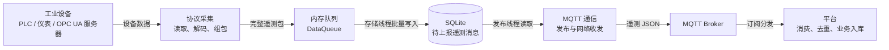
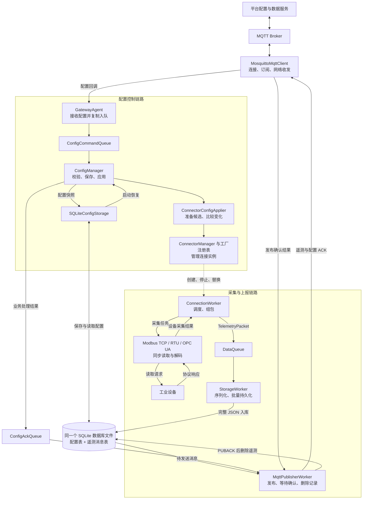
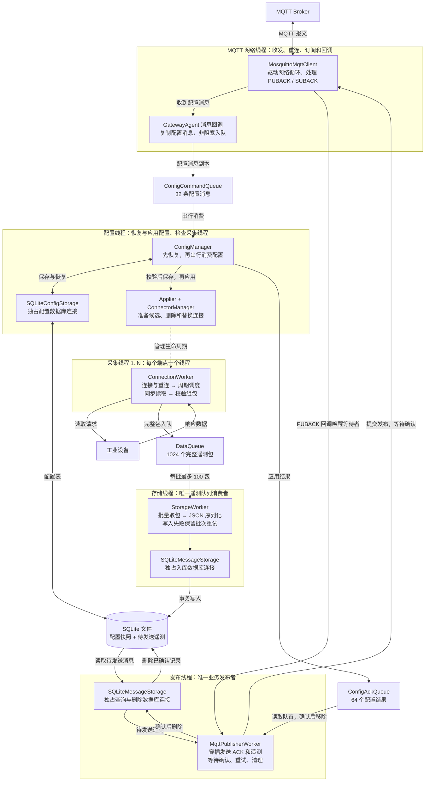
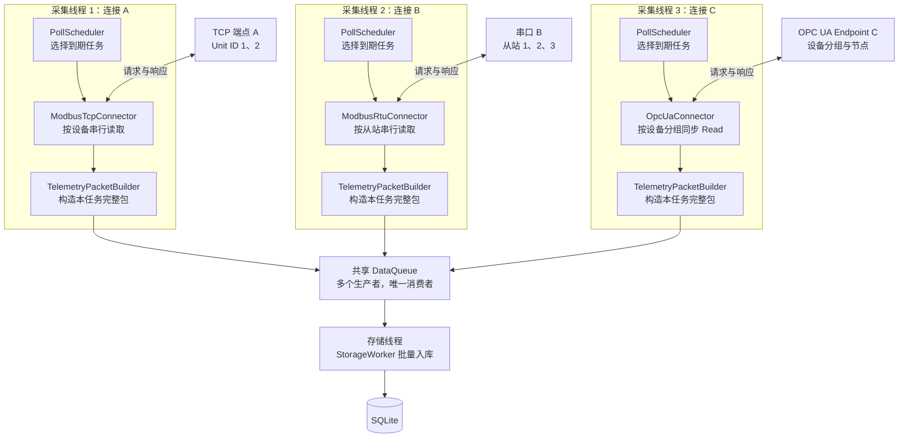
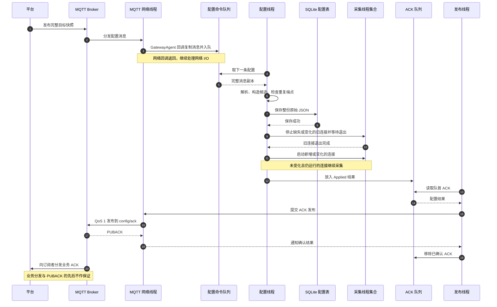
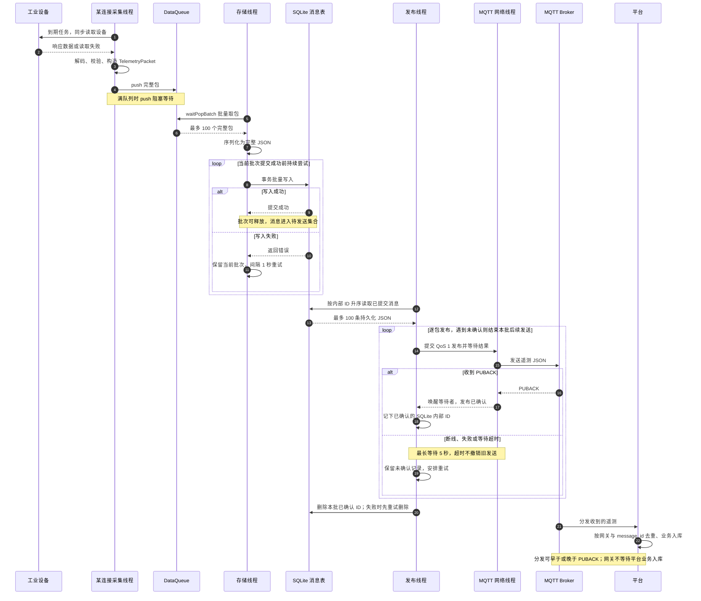
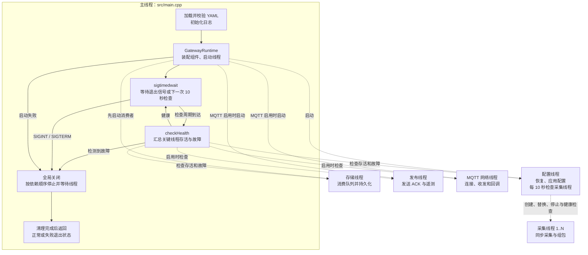

# 系统架构

本文说明当前工业网关的实现结构，以 `src/main.cpp`、`GatewayRuntime` 和已注册协议驱动为准。配置字段见 [配置指南](配置指南.md)，平台消息契约见 [MQTT 通信协议](MQTT通信协议.md)，构建入口见 [README](../README.md)。

## 1. 系统职责与范围

平台维护网关、设备和点位的目标配置，将**完整采集连接快照**发给网关。网关完成校验、本地保存、连接更新、周期采集、遥测持久化和 MQTT 上报。配置历史、平台业务入库和去重由平台负责。

当前支持 Modbus TCP、Modbus RTU 和 OPC UA 同步读取。协议模块编译进程序，由工厂注册表按协议名称创建实例；没有运行时加载动态插件的机制。

主要设计约束：一个协议端点由一个采集 Worker 管理；同一连接内串行读设备；采集结果先入库再上报；配置控制和 MQTT 网络回调分离。

## 2. 总体结构

### 2.1 大模块与遥测数据流

先从数据去向看系统：工业设备产生的数据经过采集和内存队列，写入 SQLite，再经 MQTT 发送到平台。下面是逻辑模块图，线程和具体调用在后续图中展开。

队列负责采集与存储之间的缓冲，SQLite 负责保存待发送消息。MQTT 断线时，已经入库的消息留在 SQLite，连接恢复后继续发送；只有收到 Broker 的 PUBACK，发布线程才删除对应消息。SQLite 本身不执行 MQTT 发布。

### 2.2 采集上报与配置控制的模块关系

系统有两条主要链路：**遥测链路**从设备流向平台，**配置链路**从平台流向连接管理。实线表示数据、消息或处理结果的传递，虚线表示连接管理操作；图中方框表示模块，不代表各自拥有独立线程。

`GatewayRuntime` 负责创建上述组件及管理它们的生命周期。日志是公共支撑能力，不是遥测传输的中间环节。

## 3. 代码分层与职责

| 层或模块 | 主要位置 | 职责 |
|---|---|---|
| 领域模型 | `include/industrial_gateway/domain/` | 采集任务、设备结果、完整遥测包、采集值类型 |
| 公共端口 | `include/industrial_gateway/application/ports/` | 协议、队列、配置存储、消息存储和 MQTT 接口 |
| 启动装配 | `src/bootstrap/` | 注册内置协议、连接依赖、启停、健康汇总 |
| 配置控制 | `src/application/config/` | 恢复、解析、准备、保存与应用目标快照 |
| 连接管理 | `src/application/connector/` | 工厂注册、端点占用、连接 Worker 生命周期 |
| 调度与组包 | `src/application/collection/` | 按周期选择任务、校验并构造完整遥测包 |
| 消息接入 | `src/application/agent/` | 登记配置订阅，将回调消息复制入队 |
| 遥测存储消费 | `src/application/ingestion/` | 批量消费、JSON 序列化、持久化重试 |
| 消息发布 | `src/application/publishing/` | 串行发布 ACK 和遥测，处理确认及删除 |
| 协议驱动 | `src/drivers/` | 协议配置、同步连接与读取、结果解码、工厂注册 |
| 基础设施 | `src/infrastructure/` | 配置解析、队列、SQLite、libmosquitto、spdlog 适配 |

领域数据结构不暴露第三方 JSON 类型。存储和通信通过端口传递完整消息；当前配置控制实现也直接使用了基础设施解析器和具体配置队列，并非所有依赖都已抽象成端口。

扩展协议时，需要提供配置模型及解析器、`IProtocolConnector` 实现、工厂注册函数，并接入 `RegisterBuiltInConnectors` 与 CMake。驱动负责返回规范端点标识和按周期生成任务，公共管理层不解析协议地址。

## 4. 线程和队列

### 4.1 线程职责与跨线程数据流

下面每个“线程”分组表示一个执行上下文；采集线程分组代表可重复创建的 N 个实例。队列和数据库放在线程分组之外，表示线程间传递数据的边界。主线程的装配、健康检查和关闭职责在第 8 节单独画出。

发布线程负责业务发送策略，MQTT 网络线程负责协议收发和回调；发布线程等待 PUBACK 时，网络线程继续处理网络事件。图中的跨线程发布连线表示 MQTT 客户端的调用与同步机制，不表示另有一个业务发布队列。

`GatewayAgent` 回调在 MQTT 网络线程执行，不拥有单独线程。`ConnectorConfigApplier` 和 `ConnectorManager` 在配置线程中执行，也不各自创建控制线程。三个 SQLite 存储实例各有独立连接，但操作的是同一个数据库文件。

### 4.2 多采集线程如何汇入同一个队列

以下用三个连接示意并行关系：线程 1 采集一个 Modbus TCP 端点，线程 2 采集一条 RTU 总线，线程 3 采集一个 OPC UA Endpoint。每种协议也可以配置多个不同端点，并不限制为一个协议一个线程。

每个分组内的调度器、同步驱动和组包器由同一个 ConnectionWorker 线程调用，没有再为每个设备或采集周期创建线程。不同连接可以并行；同一连接的多个设备和周期任务串行执行。共享队列满时，各生产者仍可能在入队处等待。

### 4.3 线程与队列参数汇总

| 执行线程 | 所属模块 | 主要工作 |
|---|---|---|
| 主线程 | `src/main.cpp` | 加载 YAML、初始化日志、启停 Runtime、等待退出信号、健康检查 |
| 配置线程 | `ConfigManager` | 先恢复 SQLite，再串行处理配置；管理并检查采集连接 |
| 每连接一个采集线程 | `ConnectionWorker` | 连接与重连、调度任务、同步读取、组包并入队 |
| 存储线程 | Runtime 包装的 `StorageWorker::run()` | 批量取包并持久化 |
| 发布线程 | `MqttPublisherWorker` | 在同一线程发布配置 ACK 和遥测，等待确认并清理 |
| MQTT 网络线程 | `MosquittoMqttClient` | 网络循环、重连、订阅、消息及确认回调 |

MQTT 启用时，稳定运行的主干线程数为 `5 + N`，其中 `N` 是采集连接数；MQTT 禁用时为 `3 + N`。MQTT 连接过程另使用临时辅助线程执行阻塞连接调用，因此这不是进程线程数的硬上限。

配置管理运行期间，`ConnectorManager` 只由配置线程操作。全局关闭先等待配置线程退出，再由主线程停止剩余连接，避免并发修改连接集合。驱动自身不增加业务采集线程。

| 队列 | 当前容量 | 生产者 → 消费者 | 满队列行为 |
|---|---:|---|---|
| `DataQueue` | 1024 个完整包 | 多个采集 Worker → StorageWorker | `push()` 阻塞等待 |
| `ConfigCommandQueue` | 32 条消息 | MQTT 回调 → ConfigManager | 非阻塞入队失败，记录日志；本条配置不会进入业务处理 |
| `ConfigAckQueue` | 64 个结果 | ConfigManager → 发布线程 | 非阻塞入队失败，记录日志；已完成的配置操作不回滚 |

容量目前由 Runtime 固定，未暴露为 YAML 参数。配置队列保存的是消息副本，网络回调不解析配置、不执行 SQLite 写入、不等待连接替换。ACK 发送时队首仍占容量，确认后才移除。

## 5. 连接、任务与采集包

| 协议 | 连接归属 | 同连接内的读取方式 |
|---|---|---|
| Modbus TCP | 数字 IPv4 和端口 | 多个 Unit ID 串行读取 |
| Modbus RTU | 本地串口；存在时结合字符设备号识别 | 同总线多个从站串行读取 |
| OPC UA | 规范化 Endpoint URL | 一个客户端会话，按设备分组同步 Read |

同一快照中，即使 `connection_id` 不同，相同协议端点也会在准备阶段被拒绝。端点规范化的边界见各协议文档，例如 OPC UA 不通过 DNS 查询判断别名是否指向相同服务器。

工厂按 `interval_ms` 分组生成任务。一个任务包含一个连接上该周期需要采集的设备和点位；同设备不同周期的点位进入不同任务，形成不同遥测包。

`PollScheduler` 使用单调时钟。任务首次调度立即到期；每次完成后保持原周期相位，跳过已错过的周期，不补跑所有历史轮次。连接内任务串行，读取或队列等待会影响后续任务的实际执行时间，配置周期不是硬实时保证。

Modbus 同设备同周期的点位必须能由一次连续范围读取覆盖，寄存器类型相同且范围不超过 125 个寄存器。OPC UA 同设备同周期的节点通过一次 Read 读取，不要求 NodeId 连续。

驱动返回按任务设备顺序排列的结果。正常链路中，同一设备在该任务内整体成功或失败：成功包含所有请求点位；失败使用 `Failure` 和空 `records`，具体原因写日志。组包器验证结果数量、顺序、类型及完整性；完整包使用任务完成后的 UTC Unix 毫秒时间。

## 6. 配置生命周期

下面按执行线程展开一次成功配置更新。SQLite 存储适配器在配置线程内执行，图中的 SQLite 参与者表示存储边界，并不是独立的配置数据库线程。

上图为成功主流程；任一步失败的影响如下：

| 阶段 | 失败处理 | 对运行连接和持久化的影响 |
|---|---|---|
| JSON 校验、协议准备 | 回复 `Rejected` | 不保存、不改变现有连接 |
| 保存 | 回复 `Failed` | 销毁未启动候选，运行连接不变 |
| 应用 | 回复 `Failed`，报告运行故障 | 可能只完成部分更新；目标配置已保存，不自动回滚 |
| ACK 入队或发送 | 日志记录；发送失败保留队首重试 | 配置处理结果不因此撤销；ACK 仍可能丢失 |

应用时先删除目标快照中不存在的连接，再停止并移除全部变化连接，最后启动候选实例。这允许连接交换端点，避免新旧实例同时占用一个端点。配置内容未变化且仍运行的连接继续采集。

连接比较使用协议名及规范 JSON 文本，忽略对象键顺序和空白，但保留数组顺序以及整数/浮点表示差异；不自动把省略默认字段与显式默认值视为相同配置。`request_id` 不参与连接比较，也不用于请求去重。

每次启动，配置线程先完成本地恢复，再消费已排队的新配置：

- 无记录：进入等待新配置的状态。
- 数据库初始化或读取失败：每隔 1 秒重试，暂不处理新配置。
- 读出的配置校验或准备失败：保留原记录并记录错误，继续等待平台修正。
- 有效配置在应用阶段失败：报告运行故障，由主线程关闭进程。
- 恢复成功：开始正常采集；恢复本身不更新时间戳、不发送历史请求 ACK。

当前只保存一份目标配置，没有 `desired_version`、`applied_version` 或历史版本表。数据库中的目标配置不等于已经成功运行的配置。平台应维护目标快照，避免旧 retained 消息在重连后覆盖较新的目标。

## 7. 存储与发送

### 7.1 一包遥测数据的跨线程流转

下图把内存包、持久化 JSON、MQTT 发布与 PUBACK 区分开。SQLite 表示文件存储边界，其读写操作由调用它的存储线程或发布线程执行。

采集、入库与发布是流水执行的，不要求上一包完成上报后才采集下一包。图中展示的是处理关系，平台收到消息、执行入库与网关删除记录之间没有事务或时序保证。

### 7.2 存储连接与重试规则

Runtime 使用三个独立 SQLite 存储实例连接同一个数据库文件，分别供遥测写入、遥测查询/删除、配置保存/恢复使用。线程间不共用同一存储实例。

| 表 | 字段 | 用途 |
|---|---|---|
| `messages` | `id`、`timestamp`、`message` | 自增内部 ID、包时间戳（毫秒）、完整遥测 JSON |
| `gateway_collection_config` | `id`、`updated_at_ms`、`config_json` | 固定 `id=1`、保存时间、完整目标快照 |

`messages` 没有发送状态列：存在的记录就是待发送数据，PUBACK 后删除。内部自增 `id` 用于查询和删除，与 JSON 的业务 `message_id` 不同。配置通过单条 UPSERT 原子覆盖，但“数据库保存 + 运行连接更新”不是一个可回滚事务。

SQLite 连接设置 WAL、`synchronous=FULL` 和忙等待超时。StorageWorker 每批最多取 100 个完整包，批量入库；写入失败保留当前批次并每隔 1 秒重试。序列化层对可处理的数据异常生成带诊断的 JSON，执行异常则可能导致线程故障。

发布线程按 SQLite `id ASC` 每批读取最多 100 条，逐包发送，保持存储的 JSON 内容。每次发布等待 PUBACK 最长 5 秒；未确认停止本批后续发送，保留消息，间隔 1 秒重试。确认记录删除失败时优先重试删除，不继续读取下一批。

同一个发布线程穿插发送配置 ACK，遥测初始化或删除重试期间也会尝试 ACK。ACK 保存在内存，遥测保存在 SQLite，两者没有共同的持久化事务。

这条链路允许重复发送：确认超时、确认后尚未删除时崩溃等情况都可能导致重发。它不提供端到端恰好一次交付，也不保证内存中未入库数据在异常退出后恢复。

## 8. 启动、关闭与故障检测

### 8.1 主线程如何管理工作线程

下图虚线表示主线程的生命周期管理或健康检查。配置线程对采集线程的检查和日常管理单独标出，主线程不会在运行期间并发遍历连接集合。

### 8.2 启动与关闭顺序

启动顺序：

1. 主线程设置退出信号屏蔽，加载并校验 YAML，初始化日志。
2. Runtime 检查主 YAML 的静态连接列表为空，注册内置协议工厂。
3. 启动遥测存储消费者。
4. 若启用 MQTT，先登记配置订阅，再启动 MQTT 和发布线程。
5. 启动配置线程，后台恢复 SQLite 配置，之后处理新消息。

`start()` 成功表示基础线程已启动，不表示 Broker 已连通、本地配置已恢复或设备已在线。MQTT 禁用时仍运行配置恢复、采集和存储。

全局关闭顺序：

1. 设置关闭标志，请求配置线程停止，停用配置回调。
2. 关闭配置命令队列与共享采集队列，再等待配置线程退出。
3. 停止剩余采集连接，关闭 ACK 入队。
4. 等待存储线程按现有规则处理剩余队列及当前批次。
5. 停止发布线程，最后停止 MQTT 客户端。

关闭共享采集队列用于全局退出，不能用来结束一次普通连接更新。停止发布线程不承诺排空 ACK 或遥测数据库。所有依赖对象须在使用它们的线程结束后销毁；Runtime 实例停止后不能再次启动。

主线程通过 `sigtimedwait` 等待 SIGINT/SIGTERM，并每 10 秒检查存储、配置、发布和 MQTT 网络线程。配置线程另每 10 秒检查目标配置中的采集 Worker；通常采集线程故障可能经过两级周期、约 20 秒才开始全局关闭，配置操作阻塞时没有这个上限。

设备离线、普通读取失败、MQTT 退避重连和存储重试不等于线程异常退出。关键线程故障或有效配置应用失败会记录原因，主线程完成关闭后返回失败状态；没有独立监控线程，也不会在进程内自动重启故障线程。

## 9. 已知边界与后续能力

| 项目 | 当前边界 |
|---|---|
| 满队列与停止 | 采集 `push()` 阻塞可能让单连接删除或替换一直等待 |
| 有限时间退出 | 持续存储失败、协议同步调用等可能延长关闭，未提供强制退出计时器 |
| 健康检查 | 检测已报告故障或线程退出，不检测所有存活但卡住的线程 |
| 本地容量 | 未配置遥测保留时长、数据库容量上限或自动淘汰策略 |
| 平台通信 | 心跳、availability、控制命令仅预留 Topic 名称，未接入 Runtime |
| 配置一致性 | 无历史版本、无防旧消息覆盖机制、无应用失败自动回滚 |
| 部署 | 未提供 systemd 服务、外部看门狗或进程自动拉起 |

以上未实现能力不属于现有行为承诺。协议权限、实际寄存器/节点可读性以及硬件恢复效果仍需在对应环境中联调确认。
